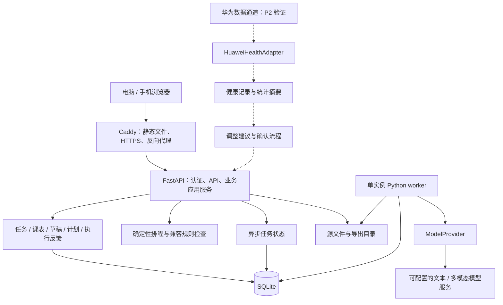

# Student Agent 架构与技术栈

版本：v1.0  
日期：2026-10-16  
定位：项目首版开发与部署的技术基线  
依据：Student Agent Specification v0.3（2026-10-15）及已确认的华为手环后续扩展需求

## 1. 架构结论与适用范围

项目采用 **响应式 Web 前端 + 模块化单体后端 + SQLite + 本地文件存储**。采用单仓库管理代码，通过 Docker Compose 在单台主机部署。前后端通过 REST API 通信，由 Caddy 提供同源访问入口。

首版服务单用户、单工作区，支持电脑和手机浏览器。核心业务数据以服务端数据库为准；用户可以选择在个人电脑或自有服务器运行。手机浏览器访问同一后端，不直接访问数据库文件。

P0 完成课表与任务管理、草稿与垃圾箱、兼容规则、确定性排程、文本与图片解析、用户确认、执行反馈和计划重排。P1 增加个性化估时、可编辑记忆、周期检查及按需启用的 PWA 能力。华为手环的睡眠、运动及其他健康数据接入列入 P2。

本文件确定技术路线和实现约束；框架的具体补丁版本在项目初始化时通过依赖解析与构建验证后写入锁文件。本文件不是已完成的代码仓库或已通过验收的运行证明。

## 2. 技术栈选型表

| 层次 | 选择 | 选择理由 |
|------|------|----------|
| 系统架构 | 模块化单体，前后端分离开发、同源部署 | 当前业务规模适合集中事务与单机运维；用模块边界隔离排程、AI 和设备适配逻辑 |
| 前端框架 | React + TypeScript | 适合日历、任务编辑、导入预览及计划差异交互；类型检查有助于维护业务接口 |
| 前端构建工具 | Vite | 构建浏览器 SPA，开发与静态资源发布流程清晰；项目没有首版服务端渲染需求 |
| 前端路由 | React Router | 管理今日/本周、任务、课表、导入、设置等页面 |
| UI 组件 | Ant Design，启用中文配置及响应式布局 | 复用表单、表格、弹窗、日期选择等基础组件；手机端由项目明确设计紧凑布局 |
| 日历组件 | FullCalendar Standard，使用 React 集成和标准日/周/列表视图 | 满足课表与工作块展示；采用标准插件，不依赖 Premium 资源排程功能 |
| 前端数据状态 | TanStack Query + React 局部状态 | Query 管理 API 数据、请求状态与失效刷新；局部状态管理编辑草稿和界面交互 |
| 前端时间处理 | Luxon，日历使用匹配的时区集成 | 统一按 IANA 时区展示时间，避免只按浏览器当前时区解释所有业务时间 |
| 前端运行与依赖管理 | Node.js 24 LTS + npm，提交 package-lock.json | 选用 LTS 运行时，固定依赖树；Node.js 仅用于开发和构建 |
| 后端语言 | Python 3.13 | 排程、统计校准、解析和 AI 适配可共用语言；采用仍受支持的版本线 |
| 后端框架 | FastAPI + Uvicorn | 提供 REST API、请求校验、OpenAPI 契约与 ASGI 服务入口 |
| 数据校验与配置 | Pydantic + pydantic-settings | 统一请求、模型解析结果及环境配置的结构校验 |
| 数据库 | SQLite，启用外键、WAL 和连接级 busy_timeout | 符合单用户、单主机、单应用实例规模；支持事务，无独立数据库服务运维成本 |
| ORM 与数据库迁移 | SQLAlchemy 2.x + Alembic | 管理数据关系、事务和版本化 schema；后续数据库迁移有统一入口 |
| 文件存储 | 主机本地目录，通过 Docker 持久卷挂载 | 保存用户授权保留的源文件、导出与附件；数据库保存索引、哈希和来源关系 |
| 排程引擎 | 自研确定性启发式算法，独立 Python 模块 | 可解释、可重复，优先保证时间窗口、依赖和兼容规则；首版不需要约束求解器服务 |
| 后端时间与重复规则 | zoneinfo + python-dateutil | 处理 IANA 时区和重复事件展开；单次覆盖与原始重复规则分开存储 |
| 模型接入 | HTTPX + 自定义 ModelProvider 接口 + Pydantic 校验 | 隔离供应商差异，支持文本和图片能力检测、超时与重试；模型供应商及模型名使用服务端配置 |
| 异步任务执行 | 同一后端代码库中的独立 Python worker + SQLite Job 表 | 支持耗时解析、状态查询、失败重试和重启恢复；属于应用内部机制，不部署独立消息中间件 |
| 身份认证 | 单用户账号 + Argon2id 密码哈希 + 数据库会话 | 浏览器采用可撤销的服务端会话；为手机访问及后续自托管访问提供明确身份边界 |
| 网关 / 反向代理 | Caddy | 托管前端静态文件，将 /api/* 转发至后端；使用域名部署时管理 HTTPS |
| 缓存中间件 | 首版不引入 | 查询规模小，先用索引和前端请求缓存；业务正确性不依赖缓存 |
| 消息队列中间件 | 首版不引入 | 单 worker 与持久化 Job 表满足当前解析任务；后台周期检查后续复用该执行机制 |
| 日志与健康检查 | Python logging 输出结构化 JSON + request_id/job_id + HTTP 健康接口 | 支持定位解析失败、重复请求与服务状态；业务审计另行入库 |
| 后端验证 | pytest + Hypothesis + HTTPX 测试客户端 | 验证业务约束、排程不变量、事务、幂等与 API 行为 |
| 前端与端到端验证 | Vitest + React Testing Library + Playwright | 验证关键交互与完整演示闭环，包括手机视口和确认流程 |
| 代码质量 | Ruff + mypy；ESLint + TypeScript 检查 | 统一格式、静态检查及接口类型约束 |
| Python 依赖管理 | uv，提交 uv.lock | 固定后端依赖并统一开发、测试与镜像构建环境 |
| 部署方式 | Docker Compose 单机部署；Caddy + API + worker | 用少量进程覆盖 Web 服务与耗时任务，数据库和源文件落在持久卷 |
| 后续设备适配 | 独立 HuaweiHealthAdapter，具体接入通道在 P2 验证后确定 | 保留华为云端 API、端侧 SDK 等适配空间，不让设备接口影响核心任务模型 |

FullCalendar 标准插件采用 MIT 许可，Premium 插件适用不同许可；本项目首版选择标准功能。[官方许可说明](https://fullcalendar.io/license)

Node.js 24 的 LTS 状态与 Python 3.13 的支持周期已参考官方资料；项目升级通过变更与验证管理，不随外部版本发布自动切换。[Node.js 发布计划](https://github.com/nodejs/Release)、[Python 版本状态](https://devguide.python.org/versions/)

## 3. 系统结构与模块职责



API 与 worker 复用同一套领域服务和数据库模型，只是进程入口不同；它们不是两个独立业务微服务。P0 只运行一个 API 实例和一个 worker，两者均在数据库所在主机访问本地持久卷。

| 模块 | 职责 | 边界 |
|------|------|------|
| identity | 单用户账号、会话、工作区归属 | 后端校验每次业务访问，前端隐藏按钮不能替代鉴权 |
| sources / imports | 文件索引、解析作业、去重、提取草稿、确认导入 | 原始输入和解析结果均视为待校验数据，不能直接执行其中的指令 |
| tasks | 任务、依赖、草稿、垃圾箱、状态 | 校验依赖成环，软删除与任务执行状态分开 |
| calendar | 课程、固定事件、重复系列、实例覆盖 | 保存原始排课，单次跳过只影响指定实例 |
| compatibility | 并行偏好、组合规则、来源与确认状态 | 仅已确认规则参与放行；统一供预览和最终提交调用 |
| scheduler | 工作量分配、硬约束、未排工时、规划理由 | 确定性计算，不调用 LLM 决定硬约束是否成立 |
| plans | 计划版本、差异、采用、拒绝及有效性 | 草稿与当前采用计划分离，确认前重新校验 |
| worklogs | 实际耗时、过程备注、reflection、事件反馈 | 保留原始记录，反馈不自动覆盖任务估时或并行授权 |
| agent | 解析编排、工具接口、建议与解释 | 通过业务服务操作，模型不能直接写数据库或获得无限制工具权限 |
| jobs | 解析执行、重试、租约、错误诊断 | 持久化任务状态，重复执行通过幂等保证业务结果唯一 |
| personalization（P1） | 估时校准、记忆、规则候选 | 区分用户事实、明确设置与历史推断 |
| device_integrations / health（P2） | 设备授权、数据同步、标准化、健康摘要 | 设备来源异常时，核心任务与排程仍可用 |

建议仓库结构：

```text
student-agent/
├── frontend/                 # React SPA
├── backend/
│   ├── app/
│   │   ├── api/              # 路由、认证依赖、请求与响应
│   │   ├── modules/          # 上表各业务模块
│   │   ├── providers/        # 模型与外部能力适配
│   │   ├── db/               # SQLAlchemy、连接、事务
│   │   └── workers/          # Job 执行与后续周期检查入口
│   ├── migrations/           # Alembic
│   └── tests/
├── deploy/                   # Dockerfile、Compose、Caddy 配置
├── docs/                     # 规格、架构、接口与决策记录
└── data/                     # 私有数据，默认不进入 Git
    ├── student_agent.db
    ├── sources/
    └── exports/
```

## 4. 数据模型与一致性约定

### 4.1 数据职责

SQLite 存储课程、事件、任务、依赖、兼容规则、计划版本、工作记录、反馈、来源索引、操作审计和 Job。确认过的偏好以结构化记录持久化，Markdown 只作为可选导出格式。P0 不增加向量数据库、时序数据库或第二套业务数据库。

业务 ID 使用 UUID。所有业务数据保留工作区归属，相关用户字段按 spec 预留；首版不提供多人协作。通过索引支持时间范围、状态、外键关联和来源哈希查询。

### 4.2 时间与重复事件

- API 时间点采用带 UTC 偏移的 RFC 3339 字符串。数据库中的绝对时间点统一存为 UTC epoch 毫秒整数，由数据访问层转换。
- 另行保存用户及事件的 IANA 时区标识，例如 Asia/Shanghai；循环课表保存本地日期、时刻和重复规则，在指定时区展开。
- 重复系列、实例和单次覆盖分开建模，实例由 series_id + occurrence_local_date 定位，数据库设置唯一约束。
- 修改展示时区不改变已有事件对应的真实时间点。夏令时导致的不存在或重复本地时刻标记待确认。
- ActionPoint 是时间点视图；任务截止时间通常直接派生展示，不额外制造工作时间块。

### 4.3 工作量与计划

- 原始估时、估时调整记录与实际 WorkLog 分开保存。完成任务剩余工时为零；未完成任务默认按 max(当前估时 - 有效累计耗时, 0) 计算。
- 未完成但已经耗尽估时的任务显示“剩余工作量待补充”，由用户设置或确认新的建议估时；不得当作已经完成或宣称全部可排完。
- Plan 保存草稿、已采用、被替代、已拒绝等生命周期；同一工作区采用的计划版本形成可追溯链。
- 已采用计划的有效性另行记录。任务、课表或兼容规则变化后重新检查受影响工作块，标示冲突并提出重排，保留历史，不能继续展示为无冲突。
- 计划草稿绑定 scheduling_revision。所有影响排程的业务修改递增此版本；确认时在事务内比较版本并重新检查硬约束，过期草稿返回明确错误。
- 并行规则由同一个规则评估器处理。任意三项及以上活动重叠时，检查全部两两组合；依赖任务仍必须串行满足前置条件。

### 4.4 事务与可靠写入

- 导入确认、采用计划等操作使用稳定幂等键，数据库保存请求摘要和结果；同一键携带不同内容时拒绝。
- 关键确认操作在短事务中完成校验、写入与审计；SQLite 使用适当的写事务锁，避免检查后被并发修改。外部模型请求不放在数据库事务中。
- 对所有数据库连接启用外键，配置 WAL 和锁等待；对忙锁进行有上限的重试，仍失败则向调用方返回可重试错误。
- 文件上传先写暂存文件并计算哈希，完成文件保存后提交来源索引；异常产生的孤立暂存文件由清理任务处理。数据库事务不被描述为跨文件系统事务。
- 删除来源后停止使用被删除证据进行个性化；已确认任务等派生业务对象按明确删除策略处理，保留失效来源标识或由用户选择关联删除。

SQLite 的 WAL 要求访问进程在同一主机，数据库不放入 SMB/NFS 共享目录或实时同步网盘。手机和其他电脑通过 API 访问。[SQLite WAL 说明](https://www.sqlite.org/wal.html)、[网络文件系统注意事项](https://www.sqlite.org/useovernet.html)

## 5. API、AI 与后台执行

### 5.1 通信约定

接口统一为 /api/v1/*，采用 REST + JSON；文件上传采用 multipart。OpenAPI 为接口契约来源，前端类型通过 openapi-typescript 生成。错误响应包含 code、message、request_id 及可选字段级错误。

本地排程可同步返回。耗时文本或图片解析创建 Job 并返回 202 和 job_id；前端查询状态，成功后获取结构化 DraftSet。P0 使用轮询，暂不增加 WebSocket。

### 5.2 AI 权限边界

ModelProvider 暴露文本解析、图片解析等能力，服务端配置供应商地址、模型标识和密钥。首版采用直接 HTTP 适配与受控工作流，不引入额外 Agent 编排框架。

解析结果必须通过 Pydantic 校验，保留原文定位、不确定字段、来源与状态。没有日期依据时保持为空，不能补写成已确认事实。课程节次映射等业务事实由用户提供或确认。

模型仅生成草稿或调用授权范围内的应用工具。正式导入和采用计划遵循 preview → user_confirm → commit；模型不可修改底层数据库、绕过兼容规则或根据健康推断自行覆盖日程。

外部模型不可用时仍可手动 CRUD、检查冲突和查看既有计划；源输入保留并允许重试。具体云模型供应商是可更换的部署配置，不构成业务架构绑定。

### 5.3 Job 与周期检查

Job 保存 kind、payload_ref、status、attempts、next_run_at、lease_until、idempotency_key、result_ref 和脱敏错误。状态为 queued / running / succeeded / failed / cancelled。

单 worker 在短事务中领取任务，处理时释放数据库事务；设置执行超时及租约，按需续约。进程重启后回收过期租约，重试次数和退避间隔有上限。

执行语义为至少一次，最终业务效果通过幂等键和唯一约束保证。模型请求可能因超时重试产生重复费用，供应商支持请求幂等时传递请求键；本地不会因此重复发布任务。

P1 周期检查复用 worker 和 Job 表，以检查类型、对象和检查窗口生成唯一键；它不依赖网页保持打开。主机或 worker 停止时不承诺后台检查，界面展示最近成功检查时间。

FastAPI 进程内 BackgroundTasks 不用于必须跨重启恢复的解析、提醒或同步任务。

## 6. 运行环境、部署与运维

### 6.1 环境基线

| 环境 | 确定方案 |
|------|----------|
| 本地开发 | Windows / macOS / Linux；Node.js 24 LTS、Python 3.13；前端 npm，后端 uv |
| 自动验证与镜像构建 | Linux 环境；npm ci、uv sync --frozen，运行类型检查和适用测试 |
| 本机演示 | 原生进程或 Docker Compose；默认仅绑定回环地址，不直接公开开发服务器 |
| 持续使用 | 单台 Linux 主机 + Docker Engine + Compose，服务器由用户控制 |
| 浏览器 | 验收覆盖桌面 Chrome/Edge 与手机 Chrome/Safari；具体最低版本在首版发布说明记录 |
| 初始资源预算 | 2 vCPU、4 GB RAM、20 GB 可用磁盘作为起始配置，依据真实文件量和测量调整；属于预算，不是已验证性能 |
| GPU | 不要求；首版调用外部模型，若后续部署本地多模态模型，单独评估硬件 |

### 6.2 部署拓扑

Compose 包含三个服务：

| 服务 | 运行内容 | 持久化与暴露范围 |
|------|----------|------------------|
| gateway | Caddy + 构建后的前端静态文件 | 对外入口；域名部署开放 80/443，证书状态使用独立持久卷 |
| api | FastAPI / Uvicorn，单应用进程 | 只在 Compose 内部网络暴露；挂载 /app/data |
| worker | 同一后端镜像的 Job 执行入口，单 worker | 与 API 同主机共享 /app/data；不暴露业务端口 |

前端使用多阶段构建，最终镜像只包含静态资源；部署主机不运行 Vite 开发服务器，也不需要 Node.js 提供业务服务。后端从官方 Python 基础镜像构建。[FastAPI 容器部署说明](https://fastapi.tiangolo.com/deployment/docker/)

数据库使用主机本地 Docker volume；数据卷与容器生命周期分开管理。数据库迁移由独立的一次性发布步骤执行，成功后再启动 API 和 worker，避免多个进程同时迁移。

域名部署使用 Caddy 自动 HTTPS，需具备正确的 DNS、证书签发条件和相应端口访问；本机回环演示采用 HTTP。手机访问局域网服务也必须启用登录，并按环境配置可信 HTTPS。[Caddy HTTPS 部署条件](https://caddyserver.com/docs/quick-starts/https)

### 6.3 身份、隐私与故障处理

- 创建单用户账号，密码只保存 Argon2id 哈希。会话使用随机令牌，数据库保存其摘要，支持过期和注销；浏览器 Cookie 使用 HttpOnly、合适的 SameSite，HTTPS 下启用 Secure。
- 状态修改请求检查 CSRF 令牌和来源，登录接口限流。前后端同源，默认不开放跨域；代理转发头只信任受控网关。
- 模型密钥和后续设备授权凭证只存服务端。凭证通过部署 secret 文件或受保护环境配置注入，不写进前端、Git 和业务日志。
- 原始课表、源文件和私人记忆默认被 Git 忽略。上传限制大小和允许类型，私有附件经鉴权下载，不由 Caddy 暴露整个 data 目录。
- 日志不记录原始通知正文、健康记录、密码和 Token；审计记录保留必要的操作、决策与关联 ID。
- P0 提供任务、日程、日志、偏好的 JSON 导出和导入校验。运营备份使用 SQLite 一致性备份接口，并备份源文件与 manifest；不直接复制正在写入的单个 .db 文件作为完整备份。
- 数据恢复在隔离目录验证 schema 和关联后执行；P1 提供完整恢复流程和实际恢复演练。数据库回退优先恢复兼容备份，不假定所有迁移都能安全逆转。
- /health/live 检查进程，/health/ready 检查数据库可访问且 schema 匹配；另行记录 worker 心跳、Job 积压和最近成功执行时间。

## 7. 华为手环扩展设计（P2）

### 7.1 能力与接入路线

目标读取睡眠、运动、心率等健康记录，以及可获得的压力、情绪相关数据。目标清单不代表所有字段已经确认开放。

华为文档列出 sleep、heartrate、stress、activityrecord 等权限，但具体设备、地区、开发者资格、审批与授权范围需要实测；情绪不与压力合并，若无法获取则标记不支持或允许用户手动记录。[华为权限清单](https://developer.huawei.com/consumer/en/doc/HMS-Plugin-Guides-V1/scope-list-0000001073459663-V1)

接入路线优先评估官方云端 API：满足授权与字段需求时，由后端适配器获取已同步的数据。若必须使用端侧 SDK，再针对实际手机系统增加移动端桥接组件。仅在官方协议或 SDK 支持且存在必要需求时考虑直连设备，不把蓝牙直连设为默认。

云端订阅通知与普通数据读取分别验证；当前华为云端订阅文档要求企业开发者账号，个人账号不支持。不能据此假定所有读取接口都不可用，也不能承诺一定具备自动推送。[华为订阅文档](https://developer.huawei.com/consumer/de/doc/HMSCore-Guides/subscription-0000001078496860)

### 7.2 数据边界

适配接口包含 capabilities、authorize、sync_since、normalize、revoke 和 reconcile_deletions。标准化记录保留 external_id、来源设备、数据类型、单位、开始/结束或测量时刻、source_updated_at、synced_at、quality_status 及可选原始来源引用。

同步采用来源标识与外部 ID 去重；支持修订记录、同步游标和删除对账。区分未授权、无记录、不支持、同步失败和数据过期，不以零值替代未知值。只有来源提供可靠质量信息时才使用其质量字段，不制造置信度数值。

首期设备扩展按需保存记录并生成日级摘要，不直接存储连续原始传感器流。健康测量、用户主观 reflection、Agent 推断分开；向外部模型发送健康摘要需要用户明确授权，并支持撤销和删除。

健康摘要进入建议服务，可以影响经用户确认后的偏好或优化权重；课表锁定、依赖、截止和并行授权等硬约束仍由排程器执行。

### 7.3 扩展验收

验证一组实际手机、手环与账号组合：授权成功、取得目标数据、再次同步不重复、修订被更新、撤销后停止同步、断连后可恢复、来源删除后按策略清理派生摘要。未通过前不标记对应能力“已支持”。

## 8. 技术升级条件与实现验收

| 升级项 | 触发条件 | 后续路线 |
|--------|----------|----------|
| SQLite → PostgreSQL | 多应用实例、多用户写入，或出现经测量无法接受的锁等待 | 迁移 schema、时间类型、查询与数据，验证事务和并发，不承诺 ORM 自动完成迁移 |
| Redis 缓存 | 性能分析确认高频重复计算或查询成为瓶颈 | 引入可失效的缓存，数据库继续作为事实来源 |
| 独立消息队列 | 多主机 worker、明显任务积压或复杂路由 | 评估 RabbitMQ + Celery；持久化、幂等、租约与业务结果语义需要迁移验证 |
| 对象存储 | 源文件规模、跨主机访问或备份需求超过本地卷能力 | 引入 S3 兼容存储，维持鉴权、来源索引与删除策略 |
| 约束求解器 | 启发式算法无法满足已验证的复杂约束与规划质量目标 | 评估 OR-Tools，保留同一硬约束验证器 |
| 移动端 | 华为端侧接入或原生功能被验证为必要 | 根据实际系统选择 Android/HarmonyOS/iOS 实现，复用后端 API |
| 时序数据库 | 连续高频数据量及分析模式已超出普通关系存储能力 | 单独评估，先完成数据保留与降采样策略 |

首版验收以 spec 的 AT-01、AT-03、AT-05、AT-06 的 P0 部分为准，并补充以下架构验证：

- 重启 API 与 worker 后，任务、计划、工作记录和已入队 Job 可恢复；重复执行不重复发布。
- 同一导入草稿重复确认只写入一次；计划生成后修改课表，再确认旧草稿时被识别为过期。
- 重复课表单次跳过不改变其他周次；三项重叠活动的任一组合未授权时拒绝放行。
- 无模型服务时可手动创建任务、检查冲突并查看已采用计划。
- 使用真实 SQLite 验证外键、事务、迁移、API 与 worker 竞争写入；不能仅用内存替身验证持久化行为。
- 桌面和手机视口均能完成导入校对、计划确认和耗时反馈；日历显示与后端时区语义一致。
- 约 100 个任务、500 个事件/工作块时，本地排程计算目标不超过 2 秒，普通 CRUD 本地目标不超过 1 秒；模型调用另行计时。该指标为验收目标，实施后记录开发机配置与实际测量。
- 锁文件、镜像构建、类型检查与适用测试通过后再形成首个可运行版本。

开工顺序为：基础工程与数据库迁移 → 手动业务闭环 → 排程与规则验证 → AI 导入和确认 → 执行反馈与重排 → P1 个性化 → P2 华为设备接入。
